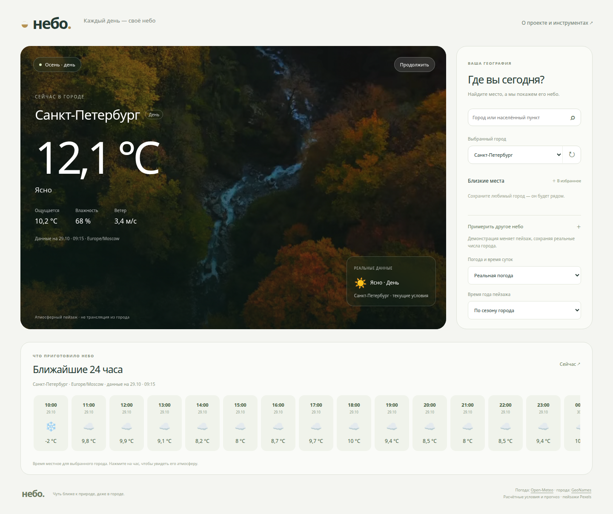

# Практика 5 — Небо

Я разработал погодный сайт и провёл новую функцию почасового прогноза через полный
цикл OpenSpec. В домашней части я использовал GitHub Spec Kit для избранных городов:
две отдельные спецификации UI и логики, общий контракт, реализация и сквозные проверки.

Код и запуск: [weather/README.md](weather/README.md).
Основной отчёт: [weather/docs/REPORT.md](weather/docs/REPORT.md).
Рефлексия: [weather/reflection.md](weather/reflection.md).

```bash
cd practices/practice_05/weather
python3 server.py
```

Открыть http://127.0.0.1:8055. Для работы сайта нужны Python 3.12, Node.js для
автоматических проверок и интернет для погоды; API-ключи не нужны.



## Соответствие заданию

| Часть | Материал |
|---|---|
| Исследование и границы фичи | [EXPLORATION.md](weather/docs/EXPLORATION.md) |
| OpenSpec: proposal/specs/design/tasks → реализация → архив | [openspec](weather/openspec/) |
| Независимое ревью и решения | [review](weather/docs/review/) |
| Постоянное правило OpenSpec и сравнение до/после | [openspec-customization](weather/evidence/openspec-customization/) |
| Другой SDD-фреймворк — GitHub Spec Kit | [.specify](weather/.specify/) |
| Две спецификации UI/логики до и после согласования, общий контракт | [001-favorite-cities](weather/specs/001-favorite-cities/) |
| Проверки и доказательства | [evidence](weather/evidence/) |
| Короткое демо защиты | [DEFENSE.md](weather/docs/DEFENSE.md) |

Практика 4 остаётся отдельной законченной работой. Её README и выводы не менялись.
Skill, MCP и hook в новом приложении используются как инфраструктура проекта;
основной отчёт этой папки посвящён требованиям практики 5.
