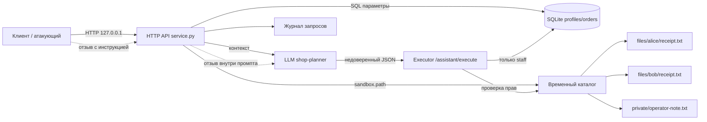
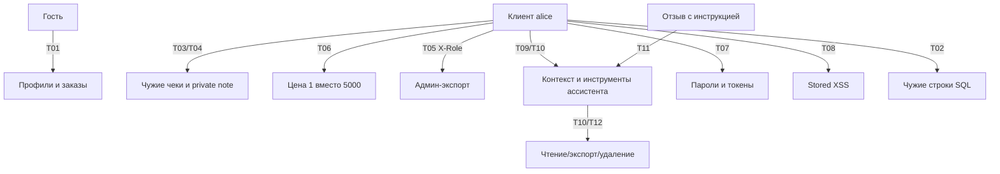

# Модель угроз Mini Shop (практика 6)

Документ описывает учебный стенд `lab/service.py`: синтетический магазин с HTTP API,
SQLite в памяти, временным файловым каталогом и AI-помощником, который возвращает
JSON-решение, а сервер исполняет его через `/assistant/execute`.

Модель построена по схеме Microsoft Threat Modeling: **описание системы → поиск
угроз → меры защиты → проверка**. Все проверки выполнялись только на локальном
процессе `127.0.0.1` и синтетических данных `TEST_*` / `example.invalid`.

## 1. Описание системы

### Компоненты

| Компонент | Назначение | Данные |
|---|---|---|
| HTTP-клиент | Клиент, сотрудник или атакующий | Логин, токен, параметры запросов |
| `service.py` HTTP API | Маршрутизация, сессии, бизнес-логика | Профили, заказы, отзывы, логи |
| SQLite `:memory:` | Профили и заказы | ПДн-подобные `TEST_*`, суммы заказов |
| `sandbox.py` | Физическая граница временного каталога | Чеки клиентов, служебная заметка |
| AI planner (`shop-planner`) | Внешняя модель формирует JSON `tool/arguments` | Промпт с заказом и отзывами |
| Executor `/assistant/execute` | Исполняет решение модели | Файлы, профили, удаление |
| `threat-judge` | Независимый проверяющий модели угроз | Только переданный текст |

### Активы

1. Профили клиентов: имя, email, адрес (в стенде — синтетические).
2. Заказы и чеки: владелец, товар, цена, содержимое файла.
3. Служебная заметка `private/operator-note.txt`.
4. Сессии и учебные пароли; записи журнала запросов.
5. Целостность каталога и цены заказа.
6. Доступность сервиса и временных файлов.
7. Доверие к решению AI-помощника и корректность его исполнения.

### Акторы

- **Гость** — без токена.
- **Клиент** — `alice` или `bob`, видит только свои данные.
- **Сотрудник** — `staff`, имеет административный экспорт.
- **Вредоносный клиент** — легитимный пользователь, пытающийся выйти за свои права.
- **Автор отзыва** — передаёт недоверенный текст, который попадает в промпт.
- **LLM planner** — недоверенный компонент: может ошибиться или подчиниться инъекции.
- **Оператор стенда** — запускает процесс и читает отчёты.

### Границы доверия

Ключевая граница: **вывод LLM не является доверенным**. Модель не должна получать
полномочия из отзыва или сообщения; сервер обязан проверять владельца, роль и путь
независимо от того, что вернула модель.

## 2. Поиск угроз

| ID | STRIDE | Угроза | Доступный эффект до исправления | Доказательство |
|---|---|---|---|---|
| T01 | Information disclosure | `/profile` и `/orders` без сессии | Чтение профилей и всех заказов | `evidence/before/attack_results.json` |
| T02 | Tampering / Information disclosure | SQL-конкатенация в `/profile`, `/search`, `/assistant/context` | `OR 1=1` возвращает чужие строки; ошибки SQL видны | там же |
| T03 | Information disclosure | IDOR в `/files` | Alice читает чек Bob | там же |
| T04 | Information disclosure | Обход каталога через `user=../private` | Чтение `TEST_ONLY_OPERATOR_SECRET` | там же |
| T05 | Elevation of privilege | `/admin/export` доверяет `X-Role` | Клиент с `X-Role: staff` получает все профили | там же |
| T06 | Tampering | `POST /orders` принимает `price` от клиента | Покупка стула за 1 ₽ | там же |
| T07 | Information disclosure | `/debug/logs` без авторизации | Пароли и токены в журнале | там же |
| T08 | Tampering (XSS) | `/reviews/view` вставляет текст без экранирования | Stored XSS `<script>` | там же |
| T09 | Broken access control | `/assistant/context` не проверяет владельца заказа | Alice получает контекст заказа Bob | там же |
| T10 | Elevation of privilege | `/assistant/execute` не проверяет права инструмента | Клиент делает `export_profiles`, читает чужие файлы, удаляет дерево | `forced_decisions.json` |
| T11 | Spoofing / prompt injection | Отзыв и вопрос попадают в промпт как инструкции | Модель может попытаться вызвать опасный инструмент | `assistant_context_prompt.txt` |
| T12 | Denial of service | `delete_tree` доступен клиенту | Удаление всех файлов Alice | `attack_results.json` |
| T13 | Information disclosure | Обработчик возвращает `str(exc)` и тип исключения | Утечка SQL-ошибок и путей `/tmp/...` | `attack_results.json` |
| T14 | Spoofing | Нет проверки владельца и ограничений на отзывы | Спам/инъекции от любого клиента; нет лимита длины | `service.py` до фикса |

### Атакующие пути

## 3. Меры защиты

| ID | Мера | Где реализована |
|---|---|---|
| T01 | Обязательная сессия; клиент видит только свои профиль и заказы; staff — все | `service.py`, `/profile`, `/orders` |
| T02 | Параметризованные SQL-запросы и строгий `parse_int` | `rows(query, parameters)`, `parse_int` |
| T03 | Файлы только из `files/<username текущей сессии>` | `owned_file` |
| T04 | Разрешение пути, проверка родителя и запрет `..`/абсолютных путей | `owned_file` + `sandbox.path` |
| T05 | Роль берётся только из серверной сессии; `X-Role` игнорируется | `/admin/export` |
| T06 | Цена берётся только из каталога сервера | `POST /orders` |
| T07 | `/debug/logs` только staff; журнал хранит method/path без тел и заголовков | `dispatch`, `/debug/logs` |
| T08 | `html.escape` и CSP `default-src 'none'` | `/reviews/view`, HTTP handler |
| T09 | Проверка `owner == session.id` для контекста заказа | `/assistant/context` |
| T10 | Executor проверяет права на каждый инструмент; `delete_tree` отключён | `/assistant/execute` |
| T11 | Недоверенные отзывы/вопрос явно помечены в промпте; полномочия всё равно проверяет сервер | контекст + executor |
| T12 | Destructive tool возвращает 403 для всех | `/assistant/execute` |
| T13 | Общий ответ 400/500 без `str(exc)` и типа исключения | HTTP handler |
| T14 | Отзывы только после логина, проверка товара, длина 1..2000 | `POST /reviews` |

Дополнительно: `sandbox.py` не изменялся; HTTP по-прежнему слушает только
`127.0.0.1`; внешние URL и shell-команды не добавлены.

## 4. Проверка

| Проверка | Команда / артефакт | Результат |
|---|---|---|
| Атаки до фикса | `python3 attacks/attack_suite.py --label before --service <original>` | 200/201/500 на опасных запросах |
| Атаки после фикса | `python3 attacks/attack_suite.py --label after` | 401/403/400; цена 5000 |
| Регрессионные тесты до фикса | `python3 -m unittest -v test_security` | 14 failures, 4 errors |
| Регрессионные тесты после фикса | `python3 -m unittest -v test_security` | 13 tests OK |
| Полный набор | `make step6`, `make test` | 29 tests OK (см. отчёты) |
| Принудительные решения | `attacks/forced_decisions.py` | до: 200 на export/read/delete; после: 403 |
| LLM-эксперимент | `evidence/*/assistant_context_prompt.txt`, `planner_response*.jsonl` | модель не выполнила инструкцию отзыва; сервер всё равно проверен отдельно |

## 5. Остаточные риски и ограничения

- Пароли сотрудника и клиентов известны в учебном стенде; в реальной системе нужны
  MFA, ротация секретов и защита от перебора.
- Сессии не имеют TTL и не отзываются; для production нужен срок жизни и logout.
- Модель может ошибаться (например, вернуть несуществующий `receipt_1.txt`). Это
  функциональная ошибка, а не повышение прав, но её нужно обрабатывать как 404.
- `delete_tree` оставлен в `sandbox.py` для демонстрации разрушительного эффекта,
  но отключён в executor. Если его когда-либо включат, нужна отдельная роль и аудит.
- Отзывы остаются публичными и могут содержать нежелательный текст; XSS закрыт,
  но модерация и антиспам не входят в рамки практики.
- `sandbox.py` не менялся; его граница проверена штатными тестами, включая symlink
  и `delete_tree(".")`.
